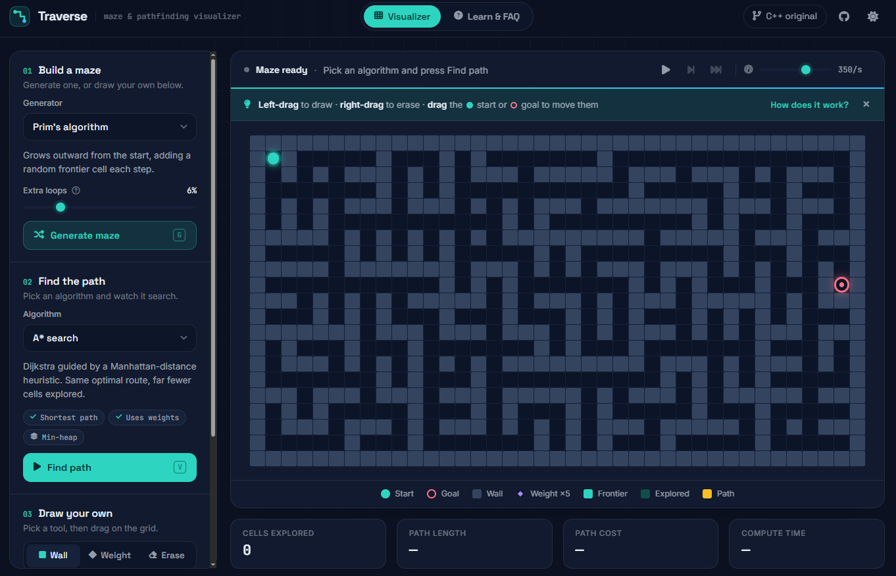

# Traverse: maze & pathfinding visualizer

Watch maze generators and pathfinding algorithms work step by step, in the browser.
Written in vanilla JavaScript with no frameworks and no libraries.

This is the web version of my C++/SFML [Maze Generator and Solver](https://github.com/tewyss/MazeGeneratorAndSolver),
rebuilt with more algorithms, live editing and playback controls.



## Features

- **7 maze generators:** recursive backtracker, Kruskal (disjoint-set union), Prim, Wilson (loop-erased random walks),
  recursive division, random walls, and weighted terrain. Perfect mazes can get extra loops.
- **6 pathfinders:** A\*, Dijkstra, BFS, bidirectional BFS, greedy best-first, DFS. Each one shows
  whether it guarantees the shortest path, whether it handles weights, and which data structure it uses.
- **Playback:** play / pause, single step, skip to end, speed from 3 to 4,000 steps per second, and a progress bar.
- **Live editing:** left-drag to draw walls or weighted cells, right-drag to erase, and drag the start or goal. A hover preview
  shows what a click will do. After a search, the path recomputes instantly as you edit.
- **Learn & FAQ tab:** what the project is for, how to use it, what every color means, an algorithm comparison table
  (shortest path, weights, data structure, time complexity), and answers to common questions.
- **Stats:** cells explored, path length, path cost, and the algorithm's real compute time.
- Light and dark themes, keyboard shortcuts, touch support, and a responsive layout.

## How it works

The algorithms never touch the DOM. Each one runs to completion instantly and records a flat list of
`[operation, cell]` pairs (carve, wall, frontier, visit, path…). A small player then replays that recording on
`requestAnimationFrame` at the chosen speed. This design gives you:

- honest compute times, because the timing measures only the algorithm, not the animation,
- pause, step, skip, and speed changes almost for free,
- instant re-solving while you drag, by applying the whole recording at once without animation.

Each cell is a `div` in a CSS grid. A state change only swaps a class, and the browser animates it with
`transform`, which stays smooth even with thousands of cells.

```
js/
  main.js        UI wiring, drawing, layout
  grid.js        board model (walls, weights, endpoints)
  generators.js  maze generation algorithms
  solvers.js     pathfinding algorithms
  structures.js  binary min-heap, disjoint-set union
  player.js      replays recorded operations over time
  renderer.js    maps cell states to the DOM
  ops.js         operation codes + recorder
```

## Keyboard shortcuts

| Key | Action |
| --- | --- |
| `G` | Generate maze |
| `V` | Visualize (run the pathfinder) |
| `Space` | Play / pause |
| `→` | Step |
| `F` | Skip to end |
| `C` | Clear path |
| `1` `2` `3` | Wall / weight / erase tool |

## Running locally

The code uses ES modules, so the page has to be served over HTTP rather than opened as a file:

```bash
python -m http.server 5173
# or: npx serve
```

Then open http://localhost:5173. It deploys as-is to GitHub Pages.
